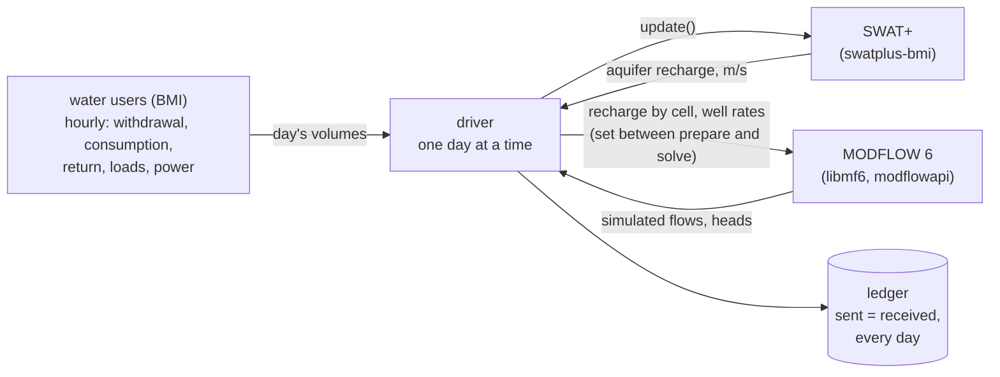

# Basin Ledger

[](https://pypi.org/project/basinledger/)
[](https://doi.org/10.5281/zenodo.23967791)
[](https://github.com/northlinehydrology/basinledger/actions/workflows/test.yml)
[](https://github.com/northlinehydrology/basinledger/actions/workflows/nightly.yml)

A basin's water, quantity and quality, balanced day by day across coupled models.

The code was written with AI assistance (Claude, by Anthropic), designed and directed by Andrew Sommerlot. See
[AI use](#ai-use).

Basin Ledger couples a watershed model, a groundwater model and the models of large water users through BMI, and
steps them together one day at a time with one Python driver:

- **SWAT+** through [swatplus-bmi](https://github.com/northlinehydrology/swatplus-bmi)
  ([doi:10.5281/zenodo.23963201](https://doi.org/10.5281/zenodo.23963201)), which runs stock SWAT+ 62.0.1 under
  outside control;
- **NextGen**, as finished NextGen In A Box runs replayed day by day, with results keyed to hydrofabric ids;
- **MODFLOW 6** through its own BMI/XMI (`libmf6`), from Python with USGS's
  [modflowapi](https://github.com/MODFLOW-ORG/modflowapi);
- **water users** as BMI components from
  [waterledger-models](https://github.com/northlinehydrology/waterledger), starting with data center cooling
  (`CoolingWaterBmi`).

Every volume and mass that moves between models is entered in a ledger twice, as sent and as received. A day where
they differ stops the run. Basin Ledger is a sibling of [Water Ledger](https://waterledger.org). Water Ledger
estimates one campus's water from public data. Basin Ledger follows that water through a basin's streams and aquifers.

**Status: early (0.1.0).** Built and tested:

- the water-user interface, with controls a rule can set (a withdrawal limit, dry mode);
- routes: MODFLOW 6 wells, SWAT+ water allocation intakes and point sources, outfalls, water from and to outside the
  basin;
- the utility chain: sources, losses, sewer, plant outfall;
- feedback rules: curtailment, dry mode, drawdown limit;
- SWAT+ recharge into MODFLOW 6 (one-way), and the two-way stream-aquifer exchange through MODFLOW 6's river package;
- NextGen as the surface model: a finished NGIAB run replayed day by day, with users on its own hourly forcing;
- MODFLOW 6 recharge from NextGen (CFE's percolation), used as interim recharge in the Plaster Creek example;
- restarts from a saved day that match unbroken runs bit for bit;
- the ledger and the command line;
- calibration records per model, and the calibration module's structure. An example is a screening run unless every
  model it runs is calibrated.

Examples:

- **synthetic:** SWAT+'s Osu_1hru with small MODFLOW 6 models, for the tests;
- **[Plaster Creek](examples/plaster-creek/), Michigan:** the worked example below;
- **[Michigan cold-stream screen](examples/michigan-cold-streams/):** a script that scores Michigan's gaged basins for
  a cold-stream study from public data. A worked example on the Dowagiac River, a groundwater-fed trout stream in
  southwest Michigan, is planned.

Still to come ([docs/design.md](docs/design.md)):

- SWAT+ built on the NextGen hydrofabric, for water quality on the same catchments;
- AORC forcing;
- applying calibration parameters, and PEST++ IES.

## How it works



A NextGen run takes SWAT+'s place as a replay. It gives calibrated flows on NextGen geography, but without feedback
(see [docs/design.md](docs/design.md#surface-models-swat-or-nextgen)).

Places are examples, not code. Each example (`examples/<place>/`) is one config file that wires real models for one
basin and its users, plus a script that fetches its public data and a short write-up. The engine knows nothing about
any place or any kind of water user.

## Worked example: Plaster Creek


An assumed 300 MW campus on its own well cuts Plaster Creek's 7-day low flow at USGS 04119055 by 43 L/s (27%) in the
driest year of the run. MODFLOW 6 takes 63% of the pumping from the streams in the last year. Glover's method, with
nextgen-michigan's screening settings, gives 89%. On utility water from Lake Michigan the creek sees nothing.

- **Calibrated:** streamflow at the gage (NextGen, KGE 0.87 in calibration and 0.81 in validation, from
  [nextgen-michigan](https://github.com/northlinehydrology/nextgen-michigan)).
- **Not calibrated:** the MODFLOW 6 model (heads RMSE 7.9 m over 55 wells; base flow too steady at low flow), the
  campus, which is an assumption, and water quality, which isn't run yet.

```bash
uv sync --group gis --group examples
uv run python examples/plaster-creek/fetch.py                     # checks for the NextGen run; says how to build it
uv run --group gis python examples/plaster-creek/groundwater/fetch.py
uv run --group gis python -W ignore examples/plaster-creek/groundwater/prepare.py
uv run --group gis --group examples python -W ignore examples/plaster-creek/demo.py
```

The NextGen run comes from nextgen-michigan (Docker, a few hours). Results are in
[docs/plaster-creek-demo.md](docs/plaster-creek-demo.md).

Open problems:

- fitting the groundwater model to heads and base flow, starting with streambed conductance, which moves the answer
  most;
- a longer forcing record that includes the 2012 drought;
- stream temperature from the change in groundwater inflow;
- water quality through SWAT+ on the same catchments, against the Plaster Creek TMDL;
- existing high-capacity wells, and more kinds of water users.

## Install

Needs Python 3.11 or later, and gfortran for SWAT+ (on macOS, Homebrew's `gcc`).

```bash
pip install "basinledger[users,nextgen]"      # or: uv add "basinledger[users,nextgen]"
```

The extras:

- **`users`:** the water-user models from `waterledger-models` (`CoolingWaterBmi`);
- **`nextgen`:** netCDF4, for reading NextGen runs.

Two model programs aren't Python packages, and come separately:

- **SWAT+** is built by swatplus-bmi, which is installed with Basin Ledger. It fetches SWAT+ 62.0.1, patches it and
  builds it, in a few minutes:

  ```bash
  swatplus-bmi build
  ```

- **MODFLOW 6's shared library** (`libmf6`) comes from USGS's release through flopy's `get-modflow`, also installed
  with Basin Ledger. Basin Ledger looks for it where `:flopy` puts it, or at `$LIBMF6`:

  ```bash
  get-modflow :flopy --repo modflow6 --subset mf6,libmf6.dylib     # libmf6.so on Linux
  ```

From a source checkout, for development and the tests, with [uv](https://docs.astral.sh/uv/):

```bash
git clone https://github.com/northlinehydrology/basinledger && cd basinledger
uv sync
uv run python examples/synthetic/fetch.py --get     # builds SWAT+ (swatplus-bmi build) and fetches libmf6 (get-modflow)
uv run pytest                                       # about a minute on one core; -m "not slow" takes about 10 s
uv run --group examples marimo edit examples/synthetic/notebook.py
```

Continuous testing:

- **On every push:** CI runs the whole suite on Ubuntu and macOS (`.github/workflows/test.yml`).
- **Every night:** a run checks against the newest releases of swatplus-bmi, waterledger-models, flopy and
  MODFLOW 6 (`nightly.yml`).

## Use

```bash
uv run python -m basinledger run examples/synthetic/surface.toml              # writes ledger.csv, series.csv, summary.json
uv run python -m basinledger run examples/synthetic/surface.toml --baseline   # the same without its water users
uv run python -m basinledger run examples/synthetic/two_way.toml --save-at 365 --save runs/warm
uv run python -m basinledger run examples/synthetic/two_way.toml --restart runs/warm --run scenario
uv run python -m basinledger status examples/synthetic/surface.toml           # calibrated, or a screening run
```

Or from Python:

```python
from basinledger.driver import Basin

b = Basin.from_config("examples/synthetic/basin.toml", run="pumping")
b.run()                       # every day of the SWAT+ project; the ledger checks each day
print(b.ledger.totals())      # m3 (and kg, MWh) per account for the whole run
b.finalize()
```

An example's config (abridged; the full schema is in `src/basinledger/config.py`):

```toml
[swatplus]
project = "{swatplus_refdata}/Osu_1hru"

[modflow6]
builder = "model:build"        # model.py writes the MODFLOW 6 simulation for the run's days

[recharge]
map = "all:aqu001"             # SWAT+ aquifers to MODFLOW 6 cells by area, or a CSV map

[[wells]]
name = "pw1"
cell = [0, 20, 28]

[[utilities]]
name = "city"
sources = [{route = "well:pw1", share = 1.0}]
losses = 0.10
outfall = "swat:point_source:wwtp"

[[users]]
name = "plant"
component = "basinledger.testing:SyntheticUser"   # or waterledger_models.datacenter.bmi:CoolingWaterBmi
withdrawal = "utility:city"
return = "utility:city"

[[rules]]
name = "plant well limit"
kind = "drawdown_limit"
user = "plant"
cell = [0, 20, 28]
head_min = 88.3
limit = 0.002
```


*The synthetic example: SWAT+'s Osu_1hru recharge drives a small MODFLOW 6 aquifer, and a synthetic user pumps one
well. Drawdown is the difference from the same run without the user.*

## Water users

Any BMI component that reports its withdrawal, consumption and return can be a water user. Its gain, storage,
constituent loads, return temperature and electricity are optional. A component that uses its own variable names is
mapped role by role in the config. The engine checks each user's balance every step:
withdrawal + gain = consumption + return + change in storage. It then integrates the hourly rates into the daily
volumes the hydrologic models take. See [docs/design.md](docs/design.md#water-users).

## What the tests check

| What | How |
|---|---|
| Hourly to daily | daily volumes equal hourly rates integrated by hand; masses summed, temperature flow-weighted |
| A user's balance | closes every hour; a component that loses water is refused |
| Any component plugs in | a renamed component with other units, and `CoolingWaterBmi`, mapped by role |
| Area maps | volume kept exactly; over-covered cells and mismatched areas refused |
| MODFLOW 6 control | values set between prepare and solve are the ones MODFLOW 6 uses; daily steps enforced |
| Recharge | sent = received every day, against MODFLOW 6's budget file and SWAT+'s own printed recharge |
| Wells | pumped = requested = the user's withdrawal, every day |
| MODFLOW 6's budget | closes every day to 1e-7 of the gross flow, with and without pumping |
| Physics | pumping draws down most at the well, and depletes the river by less than it pumps, more over time |
| Surface routes | SWAT+ takes what was asked (or reports the shortfall); the channel's flow changes the same day by what the users put in and took out |
| Utility chain | production = delivery + losses = the sum of its sources; sewer = plant outfall |
| Rules | act on exactly the days after the trigger; a curtailed user takes nothing; dry mode uses less water and more electricity |
| Two-way exchange | SWAT+'s aquifer returns nothing and stores exactly its recharge; each day's river exchange reaches SWAT+ the next day, whole |
| Groundwater transport | each species' mass closes every day; uniform recharge concentration reaches every cell at steady state; a column matches Ogata and Banks (1961) within 1% of C0; a well's user takes in the aquifer's concentration a day later |
| Restarts | saved after a warm-up and carried on, runs match unbroken runs bit for bit |
| Command line, calibration | outputs and status written; statistics on known values; the forward model writes simulated values at observations |

## Prior work

Earlier SWAT and SWAT+ couplings with MODFLOW either compile MODFLOW-NWT into one program (SWAT-MODFLOW,
SWAT+MODFLOW) or use SWAT+'s own gwflow module. See [docs/prior-art.md](docs/prior-art.md).

## Citing

Cite the archived software, [doi:10.5281/zenodo.23967791](https://doi.org/10.5281/zenodo.23967791) (all versions;
0.1.0 is [doi:10.5281/zenodo.23967792](https://doi.org/10.5281/zenodo.23967792)), and, where SWAT+ is used,
swatplus-bmi ([doi:10.5281/zenodo.23963201](https://doi.org/10.5281/zenodo.23963201)). Details in
[CITATION.cff](CITATION.cff).

## AI use

Basin Ledger was designed and directed by Andrew Sommerlot and built with an AI coding assistant (Claude, by
Anthropic), which wrote most of the code, tests and documentation under his direction and review. Whether it is right
rests on the tests: each model's own budget closes, and every transfer is checked against what the other model
received.

## Contact

Basin Ledger is built by Northline Hydrology. To work on an example or an open problem, write to Andrew Sommerlot at
andrew@northlinehydrology.com or open an issue.

## License

BSD 3-Clause ([LICENSE](LICENSE)). SWAT+ is under the GNU LGPL 2.1 and runs as its own process through swatplus-bmi.
MODFLOW 6 is public domain (USGS).
